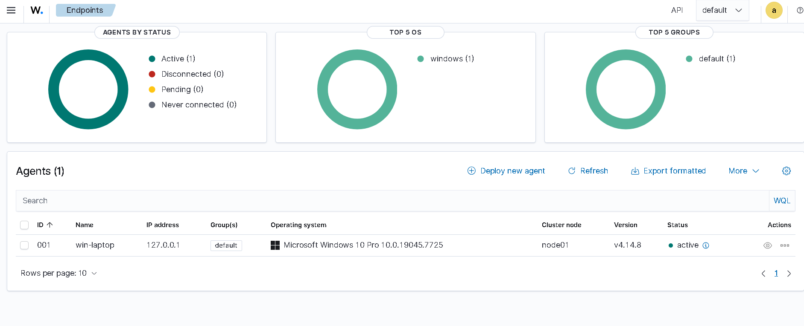
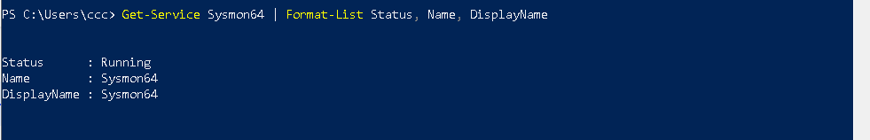
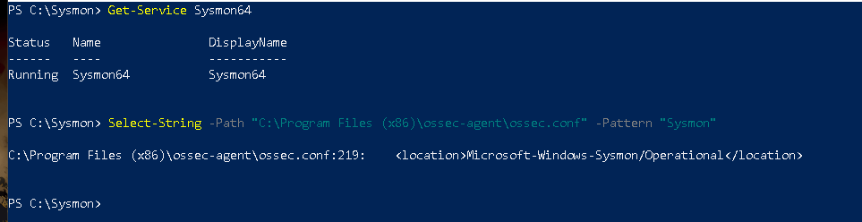
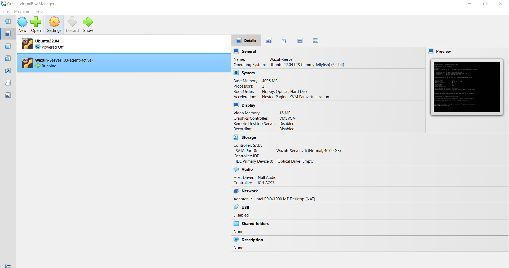
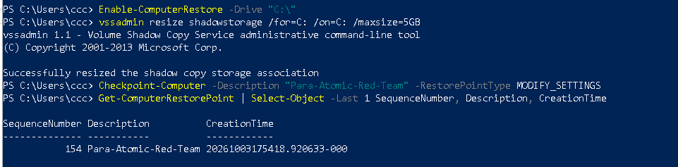
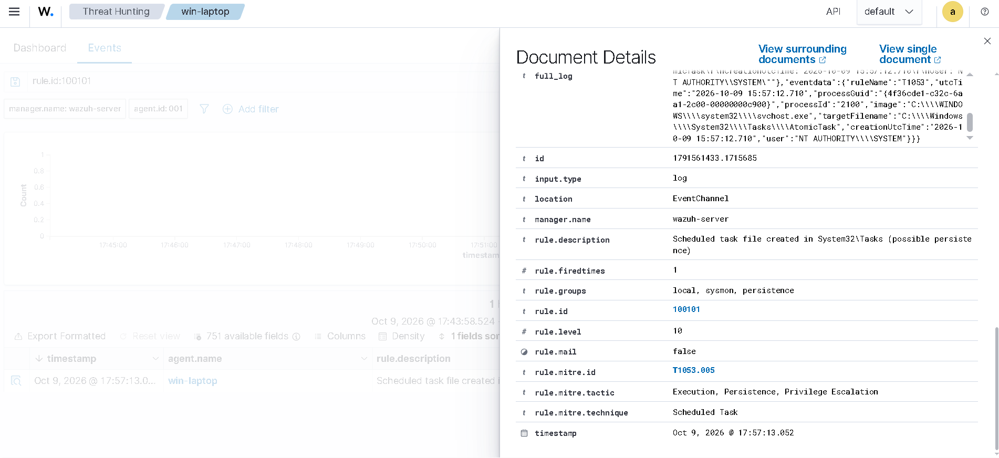

# Wazuh SOC Home Lab: alert triage and detection engineering

A small, documented SOC lab built on a laptop with 8 GB of RAM. I used it to practice what a junior SOC analyst does: collect endpoint telemetry, triage alerts, test whether detections work, and write down the result, including what I could not confirm.

Everything ran on my own machine. The attack techniques were simulated with Atomic Red Team; there was no real compromise.

## Lab setup

```
Windows 10 Pro laptop (8 GB RAM)
├── Sysmon 15.22 (SwiftOnSecurity config)
├── Wazuh agent 4.14.8
├── Atomic Red Team (attack simulations)
└── VirtualBox 7.2.20
    └── VM: Ubuntu Server 22.04.5 (4 GB RAM, 2 vCPU, 40 GB disk)
        └── Wazuh 4.14 all-in-one (manager, indexer, dashboard)
```

The agent reaches the server through NAT port forwarding (1514, 1515); the dashboard is opened at `https://127.0.0.1:8443`.

### Setup evidence

These screenshots document the lab infrastructure and endpoint telemetry setup. They complement the incident reports; they are not presented as incident findings.

<table>
  <tr>
    <td align="center" valign="top" width="50%">
      
      <br /><strong>Wazuh endpoint agent</strong><br />
      <sub>Confirms the Windows endpoint is connected to the Wazuh server.</sub>
    </td>
    <td align="center" valign="top" width="50%">
      
      <br /><strong>Sysmon service</strong><br />
      <sub>Evidence that the Sysmon service is installed and running.</sub>
    </td>
  </tr>
  <tr>
    <td align="center" valign="top" width="50%">
      
      <br /><strong>Sysmon event collection configuration</strong><br />
      <sub>Shows the Sysmon event channel configured in the Wazuh agent configuration.</sub>
    </td>
    <td align="center" valign="top" width="50%">
      
      <br /><strong>Wazuh server VM</strong><br />
      <sub>Shows the Ubuntu Server virtual machine running in VirtualBox.</sub>
    </td>
  </tr>
  <tr>
    <td align="center" valign="top" width="50%">
      
      <br /><strong>Windows restore-point preparation</strong><br />
      <sub>Documents the recovery safeguard prepared before lab testing.</sub>
    </td>
    <td width="50%"></td>
  </tr>
</table>

## Reports

| ID | Topic | Rule | Verdict |
|---|---|---|---|
| [IR-001](reports/IR-001-efsui-lsass-parent.md) | `efsui.exe` started by `lsass.exe` | 61627, level 12 | False positive. Signed Microsoft binary, hash matches. Trigger of the EFS prompt not confirmed. |
| [IR-002](reports/IR-002-disk-cleanup-dll-drops.md) | Disk Cleanup writing DLLs to `Temp` (26 critical alerts) | 92213, level 15 | False positive. Task Scheduler started `cleanmgr.exe /autoclean`. Why Windows ran it then: not established. |
| [IR-003](reports/IR-003-scheduled-task-detection-gap.md) | Scheduled task persistence (T1053.005) not detected by default rules | custom 100100, 100101 | Detection gap confirmed, two custom rules written and validated. |
| [IR-004](reports/IR-004-powershell-temp-files.md) | PowerShell writing files to `Temp` (18 critical alerts) | 92213, level 15 | False positive. Module package extraction and PowerShell script-policy test files. |

Each report lists the evidence, the steps I took, the verdict, a tuning recommendation, the residual risk and the limits of what I checked.

## Highlight: a detection gap and two custom rules

I simulated scheduled task creation with Atomic Red Team and checked what Wazuh did.

| Variant | Default rules | Rule 100100 | Rule 100101 |
|---|---|---|---|
| `schtasks /create` | Shell alerts only (level 3-4) | Detected | not tested |
| PowerShell `ScheduledTask` cmdlets | No alert | n/a | Detected |

- **100100** matches `schtasks.exe` with `/create` in the command line (Sysmon process creation).
- **100101** matches new files under `System32\Tasks` (Sysmon file creation). The task file is written by the Task Scheduler service, so the PowerShell variant never runs `schtasks.exe`.
- My first version of 100101 did not fire because Wazuh stores Windows paths with doubled backslashes. Fixing the regex solved it (details in IR-003).

Rules: [`rules/local_rules.xml`](rules/local_rules.xml)



## What this shows

- Setting up a SIEM, an endpoint agent and Sysmon telemetry from scratch, including fixing real problems along the way.
- Triage that goes beyond the alert severity: checking signatures, hashes, parent processes and Sysmon event chains before a verdict.
- Mapping behavior to MITRE ATT&CK and testing whether detections work.
- Writing and debugging custom Wazuh rules.
- Reporting with limitations stated openly, plus narrow tuning recommendations that do not hide real abuse.

## Limitations

- One lab endpoint, no real attack traffic; Atomic Red Team simulates selected techniques only.
- The custom rules are not production-ready: they need allowlists for legitimate software that registers tasks, and they do not cover every variant (WMI, VBA, registry-based, or other `schtasks` actions).
- Some root causes were not confirmed (see IR-001 and IR-002).
- Alert counts depend on the time windows I used.

## Repository layout

```
├── README.md
├── reports/       IR-001 to IR-004
├── rules/         local_rules.xml
└── screenshots/   evidence referenced in the reports
```

## About

I am a Security Studies graduate from UBT in Prishtina, specializing in Cybersecurity. I have completed the Google Cybersecurity Professional Certificate and TryHackMe SAL1, and I am building practical experience in SIEM monitoring, alert triage and detection engineering. I am seeking a SOC analyst or cybersecurity analyst internship in Prishtina or Prizren.

Contact: [ardit.dema@outlook.com](mailto:ardit.dema@outlook.com) | [LinkedIn profile](https://www.linkedin.com/in/ardit-dema-94b2b441b/)
